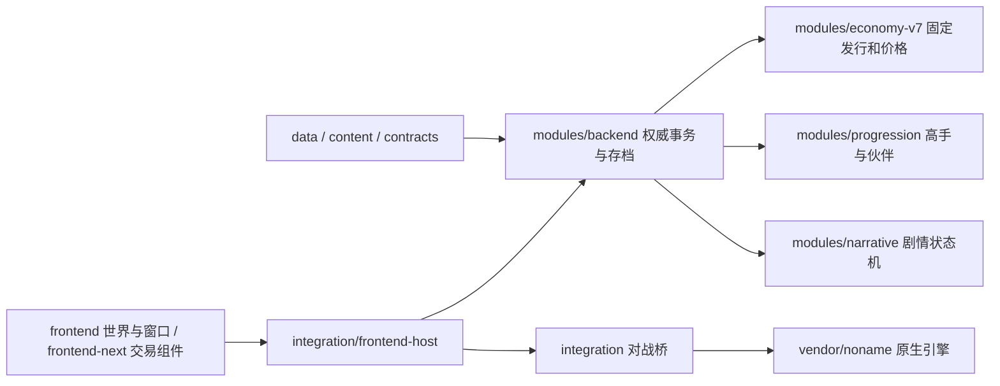

# 工程目录与维护边界

更新：2026-10-27（资源闭包修复）。适用于稳定版 `b16b8958` 之后的源码整理；不切换引擎，不更新已有 EXE，不清空玩家档案。

> **当前状态**：本文件描述现行目录职责与运行范围，不是历史草案。玩法规则见 [三赛制与定价规则](三赛制与定价规则.md)、[两回合收益论与固定发行](两回合收益论与固定发行-v1.md)、[长线经营与高手挑战](长线经营与高手挑战-v1.md)。2026-10-27 修正：`assets/frontend-bright-anime` 之前漏登记在运行范围内，现已补入并由 `tests/package-closure.mjs` 按真实构建 filter 验收。索引见 [架构文档索引](README.md)。

## 运行链路



真实对战、NPC 模拟和理论评分分别保留来源。世界存档通过 Host 的事务、稳定操作号及分支校验更新；界面、脚本工具和预览页不直接写正式玩家数据库。

## 目录职责

| 路径 | 职责 | 维护规则 |
| --- | --- | --- |
| `frontend/` | Phaser 世界、输入、外壳、统一窗口、场景对话、三模式房间 | 场景只展示状态和发出意图 |
| `frontend-next/` | 当前正式交易、设施和经营组件 | 仍在使用；不是待删除旧前端 |
| `modules/backend/` | 权威经营、库存、时钟、存档和业务接口 | 不依赖前端、测试、候选交付或工具 |
| `modules/economy-v7/` | 新经济、固定发行和封装 | 不按运行时分数修改发行配额 |
| `modules/progression/` | 高手阶段、伙伴及解锁 | 与房间、NPC 外观分别管理 |
| `modules/narrative/` | 剧情校验、执行、条件、收据与版本恢复 | 内容依赖与缺失版本不能重置业务存档 |
| `integration/` | Host、引擎桥、模式能力和 HTTP 接入 | 隔离上游版本，不把经营规则写进 vendor |
| `config/project-layout.cjs` | 桌面运行文件范围 | 新增运行目录只在这里登记；登记后必须跑 `tests/package-closure.mjs`，它会用真实 electron-builder filter 判定 |
| `assets/frontend/`、`assets/frontend-next/`、`assets/frontend-bright-anime/` | 三个正式前端素材目录（角色图集/立绘、包装图、明亮瓦片与光效） | 三者都在运行范围内；`assets/character/` 只是 `/img/` 的后备目录，正式卡图来自 `vendor/noname/image/character` |
| `data/`、`content/`、`contracts/` | 配置、发行、注册、剧情和协议 | 三者均属于运行包，不能漏打 |
| `vendor/` | 原始引擎、库及实际资源 | 动态加载，不按静态零引用裁剪 |
| `tools/lib/noname-source.mjs` | 提取工具共用的上游定位 | 默认读取本仓库 vendor，支持显式 NONAME_APP |
| `tools/audit/` | 只读结构与资源覆盖审计 | 输出在 `.local/project-audit` |
| `dev/` | 启动、诊断、监视、备份、构建和安全发布 | 不打进正式运行资源 |
| `tests/` | 当前回归、夹具、分组和结果调度 | 组清单只在 `groups.mjs` 维护 |
| `experiments/` | 素材预览、角色工具与独立实验 | 不冒充正式功能；不自动带入运行包 |
| `docs/archive/test-specs/` | 已被替代的测试规格 | 文本留档，附替代覆盖，不继续当作执行入口 |
| `deliverables/` | 外部模型候选和交付证据 | 保留本机，默认忽略；整合后正式代码进入所属模块 |
| `.local/`、`test-results/`、依赖和构建目录 | 本机状态、工具和产物 | 不提交、不通过清理操作触碰玩家进度 |

根目录 `legacy.html`、`app.js`、`shop-*.js` 和 `modules/*.js` 仍组成历史试玩路径。它们有经典脚本全局和历史存档接口，不能直接移动目录而保留失效的相对路径。当前保留这些兼容入口，并将旧行为检查与现行正式规格分开；新增业务不继续添加到这套历史代码中。

`modules/narrative/index.mjs`、`modules/economy-v7/index.mjs` 等公共导出，以及两个场景包装模块，即使没有内部静态调用，也不按死代码删除。

## 已统一的实现

- HTTP 静态文件读取统一到 `integration/http-files.mjs`，两个端口共享 MIME、流式读取、HEAD 和 Range。服务版本指纹包含该模块。
- IndexedDB 生命周期统一到 `modules/backend/indexed-db.mjs`。打开失败可重试，阻塞请求晚到时关闭连接，打开期间销毁也会结束等待；不改变事务修订检查与分库存储。
- `catalog-cache.mjs` 是每个 Runtime 自己拥有、最多三个配置的目录缓存。完整规则 JSON 作为键，避免旧日档或原地编辑规则时误用结果；失败构建不污染缓存。返回对象由业务作为只读目录使用，不跨店共享。
- 武将与核心技能提取直接读 vendor。已删除 30 份重复源码及其一个 package 标记，保留的 7,196 个技能代码条目逐项与稳定快照核对未变；仅更新来源路径。
- `desktop/electron-builder.cjs` 读取统一运行范围。包含剧情、协议及许可证，剔除开发工具、测试和历史任务文档；没有借此删改上游运行内容。
- 资源闭包验收（2026-10-27）：`tools/audit/package-closure.mjs` 递归读取正式 manifest 的资产引用，用 `config/project-layout.cjs` 求运行范围，再用 `app-builder-lib` 自己的 `FileMatcher.createFilter` 复核；`tests/package-closure.mjs` 断言 159 条引用全部入包，并钉住 5 张明亮场景贴图。此前 `assets/frontend-bright-anime` 未登记，源码可玩但打包会缺地砖、设施、光效与明亮包装图。
- 开发监视覆盖模块子目录、剧情和数据子目录。页面交互期间仍延后刷新，存档与正式端口保持原有隔离。

## 日常命令

```powershell
node dev/start-game.mjs
npm run audit:structure
npm run test:structure
node tests/run.mjs all --list
npm run test:all
node tests/run.mjs all --keep-going --failed-from=test-results/某次报告/summary.json
npm run backup:stable -- --plan
npm run backup:stable
```

备份默认放到工程外的 `../StableBackups/`，包含未忽略的工作树文件、真实二进制素材、逐文件 SHA256 和完整本地 Git bundle；依赖、测试产物、缓存及外部候选目录不自动纳入。最初稳定版快照另外保留了原有 deliverables。浏览器/Electron 存档仍在原用户目录，需通过游戏导出另存；源码备份不复制或清空它们。

恢复时在新目录克隆 bundle，再覆盖快照的 `project/` 实际文件，执行 `npm ci` 后启动。不要直接把旧快照覆盖到正在使用的目录。完整本地历史备份仅用于本机恢复；公开发布仍走过滤副本。

`tools/extract.mjs`、`tools/bundle.mjs` 会显式重建提取数据；`balance:build` 是历史基线数据构建，不能作为当前全局评分或重新发行按钮。当前评分审计入口是 `strength:report`，固定发行配置是 `data/print-editions.json`。导入上游必须显式设置 `NONAME_APP`，不再猜测机器上的安装路径，并跳过上游 Home 用户目录。

## 审计边界

结构审计用 AST 检查源码导入、HTML/CSS 静态引用和后端依赖方向，识别独立引擎端口的虚拟路径；动态加载、外部工具、公共导出需人工判断。上游完整性用 `npm run verify:engine`，不由删资源来换取通过。

目前本地上游确实缺少 43 张目录所指向的武将卡图，没有同名其他格式或旧目录副本。审计保留具体 ID、主题与是否在售；界面继续显示缺图占位，没有替换成其他武将。这不计作导入断链已修复，也不影响实物、技能和对战身份。

长线经济、复杂技能收益校准、上游内核升级仍按各自规则推进；本次整理不调整价格档位、发行数量、比赛模式或借款目标。
