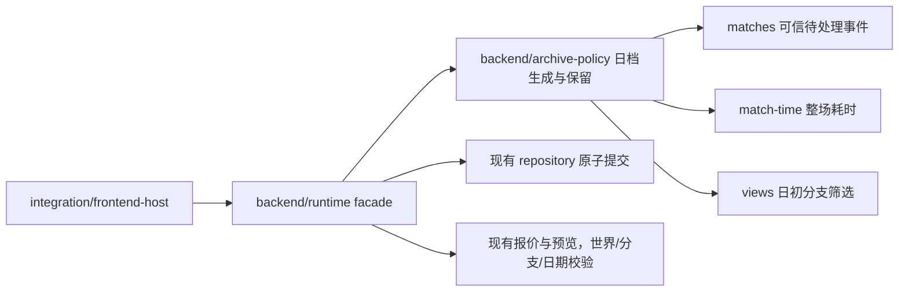

# 阶段 C 后续实施边界

日期：2026-10-27。接手基线 `73e00a14`。先读原接管包 OPT-12～18 的验收，本文是本轮实现顺序，不改冻结玩法。

恢复点：`D:\GameDev\StableBackups\NonameCardShop-73e00a14-2026-10-27T05-17-11-253Z`，17,787 文件，1,397,999,155 字节，真实素材逐项 SHA256 与 bundle 验证完成。玩家存档仍在原浏览器/Electron 用户目录。

## 依赖和切分方案（OPT-14 实施前记录）

只把现有日档生成和保留函数移到独立模块：注入 catalogFor、navigation 和 now，返回 archive/saveArchive。Runtime 仍拥有串行事务、fork、validate、唯一 repository.commit、发布通知和回执；不让 archive 调用 Host，不另开存储，不把 pending 引擎事件当新奖励。公开 createRuntime facade 不变。旧日档、日初回退和精确备份由现有日档/存储/三模式回归验证；跨结构调整最后统一跑一次完整回归。

## 实施顺序

1. OPT-13：补正全量滚动的前置状态，并提供工具侧 full/batched 对照，诊断只改临时 HTTP 响应、不改正式组件文件。选将单次调用复用静态元信息，锁定/保护/流通/收藏逐实物实时判断，不引入跨查询缓存。
2. OPT-14：按上图切分日档策略，独立提交；不为减少行数强拆其他大模块。
3. OPT-15：登记规则、兼容初始化、发行、评分 fingerprint 与目录缓存关系，用已有冻结发行/存档验证补证；显式参数不被新工具覆盖。
4. OPT-16：增加隔离输出和可复现校验入口，构建不洗掉正式精修；确认 25 人、方向帧和逻辑16/图像64约定。只在隔离目录重建并比较。
5. OPT-17：实现独立暂存与差异/能力/影响报告；读候选源码，不执行它，不切换 vendor，不自动接受新 hash/profile。
6. OPT-18：任务到有效检查的映射、证据类型与成本标签，默认去重、失败复跑可追溯；阶段性只跑相关检查，最后按实际改动做完整回归。

阶段 D 仍只设计，不在技术整理中新增户外、镀层、炒卡或下注。
