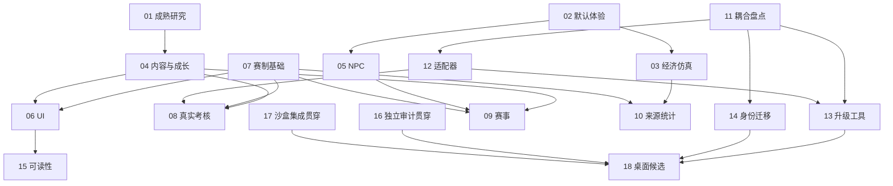

# 04：轮次、依赖与放行门槛

不估算尚未试验的模型工时，不要求 18 包同时开工。默认若干高速模型、主模型只做关键门槛。全部状态初始为 planned，用户宣布下发后才登记 assigned。

## 1. 推荐顺序

| 波次 | 可交出去的工作 | 可见产物 / 主模型动作 |
| --- | --- | --- |
| W0：证据与拆耦 | 01 成熟项目研究、02 默认三日测量、07 当前赛制注册提案、11 引擎耦合盘点；17 可用时先做收包/沙盒工具 | 四份短结果；主模型只冻结 G1 的首批方向/合同，不实现内容 |
| W1：可运行基础 | 03 经济沙盒、04 首周与考核配置、05 NPC 意图模块；12 当前版 adapter/probe、14 身份纯迁移；17 建基线沙盒 | 当前 KOF/BO3 不变，能力与候选路径可测试；主模型处理身份冲突/资金政策 G2 |
| W2：核心新循环 | 06 经营/赛事/考核 UI；07 首个扩展模式；08 一项真实考核；09 小型赛事；10 来源分桶/行情解释 | 单一完整纵向切片：经营 → 实际考核 → 交流赛 → 日结；不等全部内容完成再试 |
| W3：可维护与反例 | 13 升级流水线、15 可读性反馈；16 完整审查和反例；17 沙盒集成，原作者返工 | 候选上游 profile、迁移副本、回滚报告；主模型 G3 审证据与关键补丁后分批合并 |
| W4：首周与发布候选 | 02 首周复测、03 校准、04 剩余内容、16 关联链验收、18 桌面方案 | 完整首周体验记录与维护手册；G4 决定源码稳定及是否另做 EXE |

16 可以在 W0 就做入口/测试/不变量盘点，不等代码交齐。它的最终动态结论只绑定所审实际候选/正式基线，不提前给未来代码 PASS。17 也是持续收包角色，不是等最后才开始找缺失文件。

## 2. 依赖图

依赖表示正式验收的前置，先行研究、接口样例、纯组件和失败场景可以不等。不得在缺接口时硬编码“成功”绕过依赖。

## 3. 四名 / 三名 / 两名模型怎么安排

| 工作线 | 四名时顺序 |
| --- | --- |
| A：研究与数据 | 01 → 02 → 03 → 10；内容 04 可先于 03，按可用时间插入 |
| B：对战与玩法 | 07 → 08 → 09；等待 adapter 时做 04 内容和测试反例 |
| C：内核与维护 | 11 → 12A 当前版 → 14A 身份盘点/纯函数 → 13；12B 新版探针按依赖推进 |
| D：前端与集成 | 17A 工具/边界 → 06 → 15 → 17B 机械接入与报告 |

独立审计 16：从完成阶段任务的模型中轮换，A 审 B/C/D 的候选，B 审 A 的经济/统计；作者不审自己的包。用户可另开一名高速审计模型，但不是必需条件。

三名：A 负责研究/数据/内容，B 负责玩法/NPC，C 先内核再前端/集成；不同时开太多半成品。两名：一名玩法/数据，另一名内核/前端，阶段结束交换审查；主模型仅补无法独立覆盖的高风险判断。

不要把“高速”误当成只能抄表：07、12、14 都拆成小而可测的步骤。一个步骤失败就返具体问题，不直接升级为让主模型包办整条线。

## 4. 门槛与决策记录

| 门槛 | 输入 | 放行标准 |
| --- | --- | --- |
| G0 基线 | HEAD/关键文件哈希、已知 dirty、CORE4 验收和旧待办 | 不覆盖用户文件；不重复派发已完成项 |
| G1 首批合同 | 07/11 A 阶段、01 建议、02 初步证据 | 当前兼容映射、首个新玩法、考核证据、版本/来源字段明确；未决政策列表收敛 |
| G2 持久与结算 | 03/08/09/12/14 的纯实现、失败样例与不变量 | 钱/卡/预留/时间/资格仅结算一次；模拟不冒充牌技；迁移预演/回退清楚 |
| G3 正式接入 | 17 沙盒合并、16 独立复现、作者修复、风险摘要 | 无阻塞 P0/P1；关联场景通过；主模型只审关键差异并抽代表场景 |
| G4 稳定发布 | 首周体验、profile 升降级、资源/存档/启动证据 | 未覆盖项公开；源码版可回退；EXE 独立列包，不强制本批发行 |

每个门槛以 `decisions/G*-日期.md` 短记录冻结版本/选择/理由/影响。合同一旦冻结，下游继续做；普通实现细节无需回主模型逐次确认。

## 5. 各里程碑到底交什么

- M1：原 KOF/BO3 经注册表与当前 profile 跑通，默认三日证据与初步经济基线齐，不改变旧档体验。
- M2：一个新规则、一项真实店长考核、一场小型运营赛事、对应 UI 与日结完整可玩。内容少但闭环真实。
- M3：第二个受支持内核或明确不兼容报告、稳定身份与迁移预演、升级失败保持旧版本；不能仅有架构文档。
- M4：首周成长/经营路线可观察，统计和行情可解释，连续客流无停摆，维护/发布资料齐。未实现的多人/联机/精确恢复不进入完成清单。

M2 和 M3 可按风险分支推进，不让引擎大版本试验阻塞已验证内核上的经营改进。新内核不支持 KOF 时可以继续旧 profile，不删玩法来伪装升级成功。
