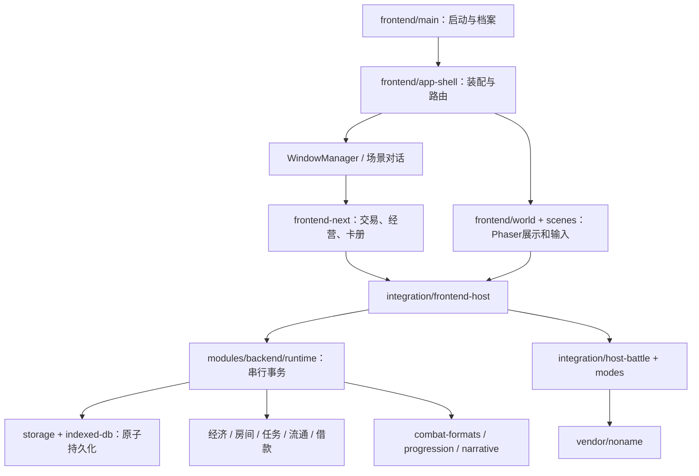

# 无名小店：全面优化开发总文档

交接日期：2026-10-27，Asia/Shanghai。面向接下来负责整体维护、排错与优化的模型。

本文件依据当前源码、上一轮验证记录和本次交接核查编写。它不是要求把所有历史想法一次做完的功能清单，也不替代使用者在新会话里的实际授权。使用者授权“按此文档全面优化”后，按阶段推进可逆的技术工作；不要每改一个文件就停止询问，也不要擅自改回已取消的玩法。

## 0. 接管后的第一件事

先阅读本目录 README、项目根目录 AGENTS.md、本文件第 1～5 节和第 12 节。确认版本、工作树、备份和当前规则，再执行任务。**最先处理的实际问题是 OPT-01：桌面打包漏掉明亮场景资源，不是继续重画角色或重写经济系统。**

建议先完成 OPT-04 基线保护，再依次完成 OPT-01～OPT-03，然后根据证据处理 P1；P2 只实施有必要、可量化且有回滚路径的调整；P3 为未来能力设计，不默认实装户外、炒卡、镀层、赌博或整套新剧情。

不要重新从聊天历史中猜规则；不要把旧设计稿、候选交付或演示页面当成正式实现。本文中“当前事实”“确认缺口”“待核查候选”“未来规划”有不同含义，不得混用。

## 1. 项目身份、版本与恢复点

### 1.1 项目目标

游戏名：无名小店 / Noname Card Shop。核心是二次元像素卡店经营：进货、销售密封包盒、拆包收藏、二级市场、NPC 牌友、店主参赛、高手挑战与伙伴经营。打牌应长期承担阶段考核和经营运营点，未来可扩展更多格式及店外世界。

已确定技术路线：Phaser 世界 + HTML/CSS 窗口 + JavaScript 权威经营规则 + 无名杀原生对战。继续维护这条路线，不在普通全面优化里更换引擎、改成大型前端框架或重写整套存储。

### 1.2 本文编写基准

| 项目 | 核查值 |
| --- | --- |
| 本机工程 | `D:\GameDev\NonameCardShop` |
| 源码运行基线 | 本地 `07fa17bd4e0649330811ad5712b9b3b6ac20ef10` |
| 同内容公开提交 | `38e855157fd794e805e86127e9fb2f1d1ac64d1a` |
| 推荐恢复标签 | `stable-2026-10-27-audited` |
| 整理前标签 | `stable-2026-10-27-before-structure-audit` |
| GitHub | `https://github.com/NagasakiSaki/NonameCardShop`，已公开 |
| 包元数据 | `0.8.1`；此版本号没有覆盖表达最近每轮源码变化 |
| 无名杀基线 | `1.11.6`，以锁定的源码和能力 profile 为准 |
| Node 要求 | `>=22.12`；前次测量运行时是 `24.15.0` |
| EXE | 旧版本保留，本轮和前轮没有发布新安装包 |

文档提交本身会产生后续 Git 提交，接手时重新读取 HEAD。不要因为文档 HEAD 不等于此表就回退；此表记录运行实现基准。`package.json.private=true` 表示不发布 npm 包，不表示 GitHub 仓库私有。

本地和公开提交哈希不同，是因为公开历史通过过滤副本排除了上游 Home 用户缓存。优先用同名稳定标签识别内容，不拿两个哈希不同当作代码丢失。

### 1.3 本机备份

备份总目录：`D:\GameDev\StableBackups`。

- `ORIGINAL-STABLE.txt` 指向整理前原稳定快照。
- `LATEST-AUDITED.txt` 指向整理后最终快照。
- 原稳定快照名：`NonameCardShop-b16b8958-20261027-010137`。
- 整理后最终快照名：`NonameCardShop-07fa17bd-2026-10-26T18-12-29-325Z`。目录时间为 UTC 命名，本地日期仍为 10 月 27 日。
- 快照包含 `project/` 实际文件、`snapshot-manifest.json` SHA256 清单、`history.bundle` 和 `RESTORE.md`。

原稳定快照额外保留了外部交付。后续备份工具默认不包括被忽略的依赖、缓存、测试结果、EXE、候选交付和上游 Home。**源码快照不是玩家存档备份**：真实游戏进度留在浏览器/Electron 用户目录，另用游戏导出功能保存。

恢复演练应在新目录进行：克隆 bundle、覆盖快照真实文件、安装依赖、用独立用户目录/端口启动。不要直接覆盖正在玩的目录。不要把完整本机 bundle 上传到公开仓库。

### 1.4 当前工作树注意事项

写交接文档之前，已有任务外修改：`docs/美术与前端独立开发交接文档.md`，SHA256 为 `D29AC6445A12EFEFE559DED5DBDEAABDC2F2693B1FB370EBE146B42585407B97`。这是原有修改，未纳入上一轮提交，不能擅自覆盖或顺手提交。接手时重查状态；若哈希变化，也不能直接还原。

`deliverables/` 是本机外部模型候选，现已忽略，但原文件仍在。不要因为 Git 看不到它就认定它被删除，不要直接全目录采纳或清空。

## 2. 信息可信度和历史冲突处理

按以下顺序裁决冲突：新会话中使用者的明确指令 → 当前可运行实现和当前配置 → 本交接中标明的冻结规则 → 最新验证记录 → 专项架构说明 → 历史设计与候选。

代码并非天然没有 bug。代码和冻结规则冲突时，先复现、确认偏差，再修实现；不是修改说明来粉饰。旧说明和代码冲突时，也不能未经检查就让实现服从旧说明。

已确认存在以下文档/声明漂移，接手必须校准：

| 位置 | 残留内容 | 当前事实 |
| --- | --- | --- |
| `contracts/card-shop-host.d.ts` 的队列类型 | `mode: 'bo3' | 'kof'` | 正式自动报名队列只使用 KOF；多人模式创建对应房间 |
| `contracts/operations-v7.d.ts` 的 DialogueOffer | 仅 talk / stage-challenge | 实际还有债主开场、债务目标等对话类型，需按运行返回核对 |
| `docs/architecture/原生多人牌局适配与队友接管.md` | 部分“Host 尚未接入/等待整合” | 三模式正式房间、真实原生桥和接管已经接入并验证 |
| `docs/architecture/剧情运行器与兼容接口.md` | 主表现是外置故事面板、自然经营不弹 | 现已有场景对话、场景触发和真实销售唤醒；旧面板仍作兼容入口 |
| `docs/architecture/对战房间与四模式评分.md` | 四模式及旧评分 | 现为三模式、两回合收益论 |
| 早期前端集成/任务书 | 96×128、通用皮肤、固定八张分页、标准包、英文顾客 | 现行素材、名单、滚动和主题规则见后文 |

旧资料保留历史价值。更新时给出日期、现状链接或明确的 superseded 标记；不要批量删除证据文件，也不要抹去历史失败记录。

## 3. 必须保持的玩法与数据规则

### 3.1 营业、时间与任务

默认新档初始可用现金 1,200，另有开店剧情借款；供应商信用额度默认 300。新建档案、继续、按天读取和档案管理入口已经存在，不能重新做一套互不相通的 localStorage 存档。

默认第 1 天 08:00 营业前准备，开门到 09:00；准备阶段可走时至 09:00。默认每现实秒推进两游戏分钟，支持 1/2/4 倍速和手动暂停。阅读窗口、场景对话、交易交互与玩家真实对局通过租约暂停；单独一个窗口关闭不能释放其他暂停原因。

NPC 对战本身不暂停经营，不在结束时额外跳三十分钟。玩家真实整场比赛会暂停时间，并只在整场结算后推进一次三十分钟。不要把每一小局都扣三十分钟。

日常任务奖励已提高并自动领取，保留显眼的实时收支。奖励、营业收入、服务费、采购现金流、已售成本和日结运营费分别统计；不能用现金增量冒充营业额或利润。

**日初读档返回该日 08:00 的世界**，包括钱、实物、随机结果、订单、阶段、伙伴、剧情游标和奖励回执。即时备份是另一个概念，不能冒充日初档。回退到奖励发生之前允许重新经历事件，但资金和已领奖标记必须同时回退，不得双重到账。

### 3.2 商品、印刷和市场

源目录有 26 个主题、2,563 个武将条目；当前销售主题 16 个、固定发行条目 1,381 个。这几个数量含义不同。

在售 ID：`refresh / yijiang / shenhua / extra / sp / sp2 / mobile / tw / huicui / sb / shiji / clan / bingshi / yingbian / jsrg / sxrm`。

停产 ID：`diy / old / key / collab / sixiang / onlyOL / xianding / newjiang / offline / standard`。不要删掉旧卡身份，也不要重新开放这十个主题供货。开局默认只解锁 `yijiang`，并赠送一盒；显式新档赠品配置可以改变数量/单位，不得在初始化时无条件覆盖。读取已有档案不能再发新手赠品。

三个不同概念必须分开：

| 字段 | 含义 | 不允许的混用 |
| --- | --- | --- |
| `currentRarity` | 当前理论强度分档 | 不能据此重印已有实物或决定旧卡能否交易 |
| `issuanceRarity` | 当前登记发行等级 | 不随评分、解锁和日报价改变 |
| 实物 `printedRarity` | 该具体副本的实际印刷等级 | 实物交易与市场准入优先看它 |

当前等级为 N / R / SR / SSR。每包五张，每盒二十四包，共一百二十张。散包四个基础槽 + 一个 R+ 槽，只有小保底；卡盒有固定配额。

- 标准发行：60N / 42R / 15SR / 3SSR。
- 已登记无 SSR 发行：60N / 42R / 18SR / 0SSR。

不同主题用哪套配方已经登记，不因强度变化或解锁其他卡包临时升级。只从本主题已登记的稀有度池出货，不跨主题偷偷补位。固定的是发行规则和盒配额，不是每个散包恰好同样五张或固定一个高稀有度结果。

旧包盒已经封装的内容不重抽，部分拆盒保留剩余密封包、内容和成本。`printVersion` 与价格/日报价版本分开，不因涨价生成另一种实物身份。修改配方或发行等级应新增明确发行版本，不批量改已有副本。

当前散包基准三档：

| 档次 | 平均理论分区间 | 基准进货价 | 基准售价 |
| --- | --- | --- | --- |
| 基础 | 小于 53 | 150 | 210 |
| 进阶 | 53 至小于 57 | 255 | 360 |
| 旗舰 | 57 及以上 | 360 | 510 |

盒价按二十四包、0.95 系数和五元向上取整等实际策略计算；伙伴折扣和玩家手动标价也可能影响成交。不要从统一毛利倒推后把 210/360/510 漂成 215/365/515。以当前报价 DTO 为付款依据，不把文档表格当结算函数。

正店零售货架只出售未拆包盒；单卡在二级市场交易，当前仅允许 SR / SSR **印刷实物**。N/R 仍可收藏、对战和丢弃。理论强度升为 SSR 不会让 N 印刷卡自动进入市场，旧 SR 实物也不能因重新估算变 N 就被当作普通卡。

进货应立即入库，旧在途/待收货订单保留兼容。采购只扣一次，拆包不复制副本，留一批量上架要考虑保护、锁定、已挂牌和实际可用副本。

### 3.3 NPC、流通与垃圾桶

顾客姓名为中文；外观和消费类别相互独立。NPC 只能用已流入市场的、自己实际持有且未被冲突锁定的牌；店主可直接使用自己的合法收藏，不受流通资格限制。

NPC 购物后在店内拆包，开出的牌即视为流入市场，保留与丢弃均如此。贫穷 NPC 的部分成员和店主可拾垃圾桶；拾取也登记流通。店主私下拆包不直接产生市场流通资格。

垃圾桶共享真实实物，次日清空所有归属的桶内卡。拾取不能复制或反复认领；店主捡回自己丢的卡保留原成本语义，别人捡走的零成本获得与原物主会计成本要分清。不要给被清空的卡重新造一份副本。

普通顾客有到店、浏览/排队、收银、拆包、整理、弃牌/拾牌、对局和离店阶段，不应新档固定挤门口。债主和主动约战高手属于剧情例外，不拿“新档只有一个演员”的旧断言把他们删掉。

顾客可用余额、预留桌费、本次访问预算、已花预算不是同一个数字。测试高价被拒前先确定要验证的是价格阈值还是预算；不要为了让顾客消费而随意绕过预算扣减或给玩家增发现金。

### 3.4 三种对战格式

| 经营格式 ID | 整场备战 | 每局出场 | 整场胜负 |
| --- | --- | --- | --- |
| `kof` | 双方各三将 | 依序单将接力 | 三将接力完成；新将摸四张，不继承阵亡者手牌 |
| `doudizhu-bo3` | 双方各五将 | 地主一将；农民两将，一人控主将 + AI 同伴 | BO3，每局换边；地主/农民身份由实际计划指定 |
| `versus2v2-bo3` | 双方各八将 | 每方两将，一人控主将 + AI 同伴 | BO3，两队结果，不把人控主将死亡直接当整队失败 |

单将 1v1 BO3 已从正式经营玩法删除。无名杀内部和旧接入中出现字符串 bo3，可能是旧适配、内部模式标记或历史入口，不代表要恢复一个第四按钮。

玩家在房间看到对手备战池。整场选将与逐局选将分开、确认后锁定合法阵容。先按卡包进入选将，支持跨包累计和返回；包内按当前模式分数降序。斗地主阵营确定后按当前地主/农民分排序。收藏可单独查看，但不得破坏当前要求的分数降序。KOF 的实战顺序是点击确认的顺序，不是浏览排序。

玩家等待匹配可收起窗口继续经营或自由行动；旧自动报名队列主要服务 KOF，多人模式创建相应房间。桌费可由店主调节；无赌注是当前正式状态，`wageringEnabled=false`。早期关于下注倍率和抽水的设想不等于已经开放赌博。

真实比赛的胜负必须来自受信任引擎消息。NPC 经营对战可快速模拟，但其结果来源必须明确，不能当作玩家真实战绩、挑战通关或评分校准样本。

队友接管是可选能力，只能接管己方合法存活席位，在安全操作边界执行；不得因此开放敌方控制、敌手牌或错误阵营判胜。

### 3.5 高手、伙伴与借款目标

第 2 天来第一个高手。当前高手击败后的下一天才安排下一位；打不过选择明日再战，下一位顺延至当前高手被击败后的下一天。不能按固定两天/三天轮换、同日反复进店或跳过没赢的阶段。

失败后可重新选将再战，必须生成新房间/对局身份，不复用上次锁定阵容。明日再战会赠送对应等级卡包，按现有收据限制避免重复领。高手使用即将解锁主题的合法武将，胜利后解锁供货并成为经营伙伴。高手名单、外观、紫色标识和分配岗位由配置与世界状态驱动。

借款开场债主是海玲，外观 `bd-umiri`。剧情借款总额 20,000，当前四期各 5,000，期限为第 7/14/21/28 天。首期目标不是“自动扣光所有营业收入”。剧情借款与进货供应商欠款分账；现有现金/信用规则不能被合并成一个 debt 字段。

可部分还款；每期一次受信任获胜的减免机会，按该期剩余目标 30%、最低 500、最高 5,000 的配置处理。首期足额完成并审核后得到户外前置资格，不代表户外地图已做完。不要用按钮点击或模拟赛伪造减免。

### 3.6 两回合收益论评分

采用用户指定理想环境：两个完整个人轮次，每轮正常摸二、己方一次一伤、回合外承受一次一伤。和同身份四血白板比较，公共摸牌、基础输出和基础受伤不重复计分。

```text
CE = 净牌差 + 2 × 技能净血差 + 2 × 初始体力差 + 少量强中/拆装奖励
场景分 = clamp(50 + 5 × CE, 0, 200)
斗地主分 = (地主分 + 农民分) / 2
全局定价分 = (KOF分 + 斗地主分 + 2v2分) / 3
```

偷敌一张是两牌差；弃一张拆敌一张净牌差为零；队友间转移不是凭空生牌。发动成本、主动失去体力、限定次数、互斥选项、合法目标数、有效治疗和防伤后的受伤触发都要一起算。

强中每次仅 0.15 CE，最多两次；拆装备额外 0.1 CE，场景只给一件初始敌方装备且不预设补装。不要再计一遍基础伤害或装备本身的牌差。

模型 ID 为 `ideal-two-round-1`。复杂 X/Y、觉醒、使命、多刀、额外回合、技能获取和配合链并未全面校准，必须保留“估算/待复核”和解释。理论分不是胜率；低可信分也不等于该武将已经被证明很弱。收益论采用用户选定的模型，并不存在本项目已证明的“官方统一强度公式”。

## 4. 结构地图：从哪里改



| 工作范围 | 主要入口 | 不该承担的职责 |
| --- | --- | --- |
| 启动、档案选择 | `frontend/main.mjs`、`frontend/ui/start-menu.mjs` | 新造独立经济/存档 |
| 窗口栈与暂停 | `frontend/ui/window-manager.mjs`、`frontend/v7-dialogue.mjs` | 发钱、解锁、宣布胜利 |
| 地图、角色与移动 | `frontend/world/`、`frontend/scenes/world-scene.mjs`、`modules/backend/navigation.mjs` | 用视觉位置绕过交互距离校验 |
| 正式设施窗口 | `frontend-next/screens/stations.mjs`、`components/stations/` | 在 UI 自行抽卡、扣钱 |
| 收藏和市场 | `frontend-next/screens/workspace.mjs`、`components/workspace/` | 按名字或分数合并实物身份 |
| 房间与选将 | `frontend/combat/v7-room.mjs`、`pack-selector.mjs`、`round-select.mjs` | 直接签发引擎结果或构造免费库存 |
| 权威事务 | `modules/backend/runtime.mjs`、`world.mjs`、`common.mjs` | 偷偷依赖 DOM/前端/候选代码 |
| 商品发行和价格 | `products.mjs`、`product-catalog.mjs`、`v7-policy.mjs`、`modules/economy-v7/` | 用新评分重抽旧盒 |
| 理论评分 | `catalog.mjs`、`ideal-yield.mjs`、`strength-modes.mjs` | 自称实测胜率、改变印刷 |
| NPC 和流通 | `trading.mjs`、`visits.mjs`、`trash.mjs`、`customer-demand.mjs`、`npc-tables.mjs` | 为了消除卡死直接删除钱/卡/牌局 |
| 伙伴与目标 | `operations-v7.mjs`、`modules/progression/`、`campaign-loan.mjs`、`debt-challenge.mjs` | 与 UI 草稿共用权威进度 |
| 档案和存储 | `profiles.mjs`、`storage.mjs`、`indexed-db.mjs` | 批量清空整个 origin |
| 原生接入 | `integration/host-battle.mjs`、`integration/modes/` | 改写 vendor 技能来迁就经营 UI |
| 剧情工具与内容 | `tools/story/`、`content/story/`、`data/story/`、`modules/narrative/` | 在 JSON 台本执行任意脚本或网络代码 |
| 构建、备份和发布 | `config/project-layout.cjs`、`desktop/electron-builder.cjs`、`dev/` | 把依赖、Home、测试档和交付包公开上传 |

`frontend-next/` 是正式运行的一部分，不按名字“淘汰”。根目录旧试玩脚本、`legacy.html`、`modules/*.js` 和显式 classic/previous UI 仍有兼容用途；如要退役，先证明调用方、旧档/用户入口和测试已迁移，再分阶段删除。

公共 `index.mjs`、场景包装、被动态 import 的脚本、上游技能和音频，不能仅凭静态引用为零删除。五个已知零静态调用候选在结构审计报告中，是待人工复核名单，不是删除清单。

## 5. 关键接口和事务约束

### 5.1 Host 公共面

Host 基础协议 `card-shop-ui/1.0`，按 `connect/query/command/subscribe/pause/world.input/battle` 分工。具体签名和返回以源码为准，`contracts/*.d.ts` 要与之同步。

```js
const quoted = await host.query('supplier.basketQuote', {
  lines: [{productId: 'yijiang', unit: 'pack', quantity: 1}],
});
if (!quoted.ok) return showError(quoted.error);
const request = {
  requestId: crypto.randomUUID(),
  type: 'supplier.placeBasketOrder',
  quoteId: quoted.data.quoteId,
  payload: {},
};
const result = await host.command(request);
// 若响应丢失：查 operations.get({requestId: request.requestId})，
// 必须重发时仍使用原 request；不得换 UUID 再扣一次。
```

这是交易形状示例，不免除供货解锁、交互距离和时效检查。`quoteId/previewId` 当前常在请求顶层，不能随意搬到 payload。所有数量为严格整数，资金按整数货币单位处理。

### 5.2 常用查询和命令导航

| 领域 | 常用查询 | 常用命令/入口 |
| --- | --- | --- |
| 店铺 | shop.snapshot、ledger.daily、ledger.live | business.open / close / nextDay、clock.setManualPause |
| 库存 | inventory.list、inventory.sealedSummary、inventory.surplusPreview | inventory.setProtection / discard / recover |
| 供货 | products.list / contents / quote、supplier.basketQuote / orders | supplier.placeBasketOrder / placeOrder / receive |
| 拆包 | opening.preview | opening.execute、boxes.unseal |
| 零售 | retail.list、checkout.status | retail.list / listAll / withdraw / setPrice |
| 市场 | market.list / quote、cardStats.summary | market.placeListing / listSurplus / cancelListing / acceptTrade |
| 房间 | combat.formats / rooms / room / eligible / series / roundPlan | combat.room.create / prepare / cancel、combat.prepareSeries / selectRound / start / surrender / restartRound 等现有入口 |
| 伙伴/目标 | progression.status、challenges.status、allies.list、longTerm.status | dialogue.respond、伙伴岗位和借款还款等现有命令 |
| 剧情 | narrative.available / session | narrative.enable / start / advance / choose / defer |
| 存档 | saves.days / list、operations.get | saves.create / load / loadDay / import / export |

此表是查找入口，不是新的 API 规范；任何不确定的名字先到 `runtime.mjs` 的 query/command 分派或具体领域模块检索。包内附带静态接口盘点，不能代替校验动态路由及载荷。

### 5.3 身份和副本

- `worldId` 是卡店世界，`branchId` 是当前读档分支，`revision` 是事务修订，不可相互代替。
- 卡牌身份看 `cardKey/generalId/skillVersion`；副本身份看 `inventoryRef`；印刷看 `printVersion/printedRarity`；商品/价格/评分分别有版本。
- 房间、整场、小局、引擎实例、profile 和计划摘要都有身份。换将、换局、读档后旧 iframe 的消息不能生效。
- 同武将多个副本可聚合显示 xN，但执行操作必须绑定确实可用的实物；不同技能版本、印刷、锁定状态不合并成一个可任意扣减的数字。

### 5.4 原子性、重试与查询纯度

沿用现有串行队列、fork、validate、repository.commit 和提交后 publish。副作用不能先发奖后写游标，不能在 reducer 内递归 `Host.command`，不能 await 网络后继续改同一 fork。

报价/预览绑定分支、商品版本和时间；输入或库存变化后重新报价，但“上次操作结果未知”先查原操作。确认失败要区分过期、余额、距离、锁定、并发修订和技术中断，不能一概显示 Failed to fetch。

查询允许发出短期报价/预览凭据，但不得改变钱、卡、进度或消耗出货 RNG。UI 重绘不能触发抽卡或领奖。纯视图缓存不是权威状态；失效范围与容量必须明确。

### 5.5 租约和生命周期

每个窗口、场景对话和玩家比赛拥有自己的暂停原因。关闭顶层详情时下层窗口仍暂停；关窗、读档、切店、挂载超时、加载中销毁和重复 dispose 都必须释放自己拥有的订阅、计时器、输入和租约一次。

只显示最上层窗口；下层保持状态但隐藏/inert。关闭详情恢复原窗口、所选条目和滚动位置。晚到请求先校验 world/branch/窗口存活，不能把旧结果画回新档。

NPC 主动约战会停止当前移动。处理完对话后是否恢复原自动路线属于待优化体验，须显式保存/校验意图；不能为了“恢复移动”在已切档、已关店或目标消失后继续提交交易。

## 6. 存档、迁移和恢复边界

默认世界仓库为 IndexedDB，当前记录结构包含 schemaVersion、revision、world、archives、requests。档案目录是另一数据库；每个独立 profile 又有自己的世界库。原 legacy 库和新 profile 名称不可混用。端口/浏览器/用户目录改变也会改变看到的进度。

完整即时世界和日初历史不能每 tick 重复重写所有大世界。当前档案快照已拆分存储，按元数据读取时需重新水合；不能把缺失 archive 世界当成空店覆盖。

迁移保持钱包、实物、旧订单、封装结果、来源、原成本、比赛记录和剧情依赖。未知未来剧情状态版本保留并暂停解释，不清空。读档创建新分支并处理分支祖先；旧成功请求不能冒充新分支操作成功。

测试需覆盖多标签并发提交、容量不足、打开被阻塞、瞬态失败后重试、打开期间销毁、导入损坏、升级中断、日档缺块、旧请求迟到和保存失败。真实用户档案只读/导出也必须有明确任务目的；本轮优化优先用合成隔离档。

原供应商欠款和新剧情借款是不同账本。不能在迁移时把 `wallet.debt` 清零或将其与 `campaign` 欠款直接相加后从可用现金扣除。

## 7. 原生引擎与未来升级兼容

当前扩展边界是 `integration/modes/` 和 `modules/combat-formats/`。无名杀唯一源码来源是 `vendor/noname`；已移除重复 `tools/_chars`、`tools/_core`，不要重新复制回来。

模式能力由锁定 profile、文件 hash、版本及运行握手共同决定。当前斗地主 native 为 doudizhu/normal，2v2 为 versus/two；桥接只替换必要的选将入口，保留原生打牌、死亡、阵营和 AI 流程。

消息核验必须包含 origin、当前 frame.contentWindow、随机 token、world/branch/match/game/round/profile、planHash 和 ready 前置状态。UI 不能自己写 `originVerified=true`。重复相同结果幂等，冲突结果应中断并记录，不挑一个“更像赢家”的结果。

挂载失败、超时或不兼容是技术中断，不是玩家输了，也不能伪造赢来解锁。副本锁、预留费用、整场时长、战绩和挑战奖励由 Host 管理，一次性结算。

目前 seed 没覆盖原生全部随机调用，也没有完整小局中盘序列化恢复。重新挂载和精确重放不是一回事。不要宣称有可信赌博重放、跨版本原生即时续局或全技能认证。

未来上游升级应按以下管线设计：

1. 新版本导入独立暂存目录，记录版本、来源、许可证和清单；不覆盖正在使用的 vendor。
2. 检查 import 结构、核心钩子、模式和资源差异，形成可审阅兼容报告。
3. 运行资格扫描、三模式 ready、自然对局、受控边界和多局桥接检查；证据分开记录。
4. 新建 profile 版本并核对其 hash，不自动把“检测到的任何 hash”登记为信任。
5. 卡牌 ID/技能版本映射、旧印刷引用和存档恢复另行评估；不直接全库换 cardKey。
6. 保留旧内核/旧内容恢复路径，明确技术不兼容时的降级说明，不用随机模拟代替玩家原生赛果。

本轮默认只改好接口、报告和兼容测试，不自动下载或切换到最新无名杀。

## 8. 美术、像素和前端交互要求

整体方向：明亮精致的二次元像素卡店，木板、黄纸与三国杀卡册质感。氛围可参考用户接受的早期宝可梦式四向行走及东方夜雀食堂式细致场景；不要照搬其成品素材，不把“像素风”当成降低分辨率和模糊脸的理由。

现有五团外观共 25 位，band ID 为 `mygo / avemujica / yumemita / millsage / ikka-dumb-rock`。保留全部 25 位，只移除通用模型这一决定已经执行。角色外观仅作为外形参考，不要求顾客职业、人设和原作品剧情一致。

| 项目 | 当前基线 | 修改要求 |
| --- | --- | --- |
| 逻辑导航网格 | 16 px | 不因美术细化把坐标、碰撞和锚点整体乘四 |
| 细化地砖采样 | 图集 frameSize 64；映射到逻辑 16 | 区分图像分辨率与世界单位 |
| 行走单帧 | 64×64，四向各八帧，共三十二帧 | 保留脸、侧脸、摆臂和服装分层 |
| 立绘 | 128×224 | 取用户提供原图与登记转换结果，保留来源和配置 |
| 头像 | 96×96 | 面板、台词和设置读同一登记信息 |
| 图集方向 | 以每个角色 manifest.directions 为准 | 例如爱音 up=0/left=1/down=2/right=3，不能硬编码旧顺序 |

原图路径曾提供为 `C:\Users\lenovo\Desktop\OurNotes_BanG_Dream剧情\全部角色基础全身立绘`，本次核查存在。工具应支持配置输入目录，不能让其他机器必须拥有该绝对路径。原图只读，记录文件名、SHA256、裁切/缩放/调色参数和输出 hash。

对应入口：`tools/character-kit/`、`tools/portrait-kit/`、`tools/frontend-art-bright/`；预览页在 `experiments/character-art`、`experiments/character-portraits`。可用 CLI、确定性 PNG 生成/转换和可编辑配置，不要求后续模型具有直接画图的多模态能力。不能在正常工具重建时覆盖人工精修或改变源图。

所有 NPC 头顶有适中姓名与类别，大小、遮挡和缩放可读；店长自己的标识可不同。设施需看得出用途、交互站位可到达；装饰不能改写后端碰撞。场景昼夜、灯光、角色遮挡与动态场景素材分别处理。

交易、卡册和选将主体采用用户现在要求的滚动，不倒退到固定八张分页。包盒页面逐组展示一个大商品和本主题完整卡册；不等于所有页面一刀切用同一种布局。选择、收藏、改价、异步刷新和详情返回不得跳回开头。

有卡面的卡牌右键能打开技能详情，移动端提供等价可见入口。原始卡图完整等比显示、xN 数量、印刷/强度区别、技能文本和按需源码需继续可用。确认按钮窄屏/短屏可达，避免用裁切隐藏重要操作。

界面语言面向玩家，不展示候选编号、DTO、原始异常栈和内部版本串作为主要提示。调试诊断可以放独立开发区，不藏掉玩家实际需要知道的预算、锁定原因、对局状态和交易是否已完成。

## 9. 剧情系统和户外扩展

现有结构包含 JSON 制作源、校验、编译出的不可变 storypack、运行游标、事件等待、条件/动作注册、历史内容加载与场景表现。它参考过成熟对话引擎的分层方法，但没有实际引入 Yarn/Ink 或服务端消息队列。

制作源：`content/story/corner_card_shop/`；生成包和索引：`data/story/`。发布后的 campaignId + contentRevision 内容不可原地变更。改台词或逻辑应升修订并保留旧包；会话继续绑定完整 contentHash，不靠改 hash/清游标强行兼容。

主体验是 `frontend/v7-dialogue.mjs` 的场景对话。旧 `frontend/ui/story.mjs` 保留兼容/调试用途，不应作为新主线体验的唯一路径。场景进入、NPC 主动接近、真实成交或目标完成可触发；等待经营条件时只释放剧情自己的暂停。

基础节点 line / choice / wait / action / end，加上已登记的 branch / cue / transition 等扩展。未知节点和能力明确拒绝，保持原有安全步数、深度和容量限制。剧情 JSON 不允许 eval、远程 import、任意脚本路径或直接改钱包。

副作用和游标、回执在同一次业务事务里提交。幂等效果绑定会话与效果，不把当前 branchId 放进效果键导致读档后重复发奖。触发依据来自真实业务事件和保存的等待证据，不只反查最近一千条展示日志。

当前已有示例章节和接口，不代表商业级六章主线、图形化剧情编辑器、完整演出系统和户外玩法已完成。本次不替用户写完整剧情台词。

未来编辑器应优先做“图形/表单编辑源 → schema 校验 → 条件预演 → 编译新修订 → 隔离试玩 → 版本审查”的闭环。明确输入和输出，不直接编辑玩家存档或已发布包。

未来户外先设计地图/地点注册、旅行意图、离店期间经营政策、时间消耗、进入/离开钩子和存档语义，再连实际场景。现有 transition 没有旅行能力时走失败出口；不能直接传坐标就宣称户外已开放。

## 10. 前轮已做完的事：不要重复推倒

- 清除重复上游代码约 17 MB；7,196 个技能代码条目内容未变，只更新来源路径。
- 提取工具默认读本仓库 vendor，导入新上游必须显式 NONAME_APP，跳过 Home。
- 两端 HTTP 文件逻辑统一为流式、HEAD/Range/MIME 实现。
- 世界和档案目录共用可重试 IndexedDB 连接，处理阻塞、晚到连接和打开时销毁。
- Runtime 的武将目录缓存是每店最多三套、完整规则键，不跨店共享。
- 统一构建范围、补齐剧情 content/contracts；但本次另发现明亮素材仍漏打，见下一节。
- 测试分组、去重、唯一日志路径、失败项重跑已实现。
- 旧规格归档十份，当前滚动、场景剧情和主要交易/对局有替代检查。
- 原稳定版和整理后版都有本机完整素材快照与 Git bundle；公开使用过滤发布。

下一位模型不应再创建另一套缓存、另一个存档仓库、并行 WindowManager 或第二份上游副本。需要调整时先检查既有实现和失效策略。

## 11. 已验证内容及证据限制

前轮最终完整执行有 63 个独立测试，62/63 通过。唯一失败是新剧情夹具在读档后释放暂停，准备阶段时钟已走了 0.195 游戏分钟，却仍断言精确 08:00；修正夹具为持有自己的核对暂停后，该项单独复测 1/1 通过。之后结构专项补充了备份路径检查，3/3 通过。**没有篡改原失败报告，也不能说一轮完整 63/63 一次通过。**

桌面源码存档菜单、导入导出/备份、沙箱和服务关闭单独通过。electron-builder 的实际配置加载/合并和 schema 校验通过，但没有构建新 EXE，也没有验证包内资源闭包完整。

原生引擎按既有 manifest 核对通过 15,876 个文件、1,340,042,134 字节，排除了 450 个上游 Home 用户文件。这只是基线完整性，不代表每个武将每个技能都自然对战通过。

结构 AST 审计覆盖 428 个源码文件、1,136 个静态引用，静态导入断链和后端跨层依赖为零。它不等于覆盖了所有动态资源、资产清单、状态边界或内存泄漏。

隔离内存世界 `createRuntime + connect`，同机 Node 24.15.0、模块预加载、两版各三次交替：中位数约 2449 ms → 825 ms。不能推导整页加载或 FPS 相同比例提升。千行收藏滚动及部分输入已验证，不等于所有机器长期流畅。

原生 ready、自然 AI 对局、受控死亡/注入结果夹具、后台模拟和逻辑单测必须标注不同证据类型。既不能把自然单场当全技能认证，也不能把有效的受控边界检查全部当成无价值“假测试”。

## 12. 已确认缺口与优先级

### C-01：明亮场景素材漏出桌面运行范围，P0

本次交接新增核查：正式 `assets/frontend/manifest.json` 有 82 个资产路径，其中以下五个磁盘文件存在，但均不匹配当前 `config/project-layout.cjs` 生成的 runtime filter：

```text
assets/frontend-bright-anime/tiles/tileset.png
assets/frontend-bright-anime/props/props.png
assets/frontend-bright-anime/fx/glow.png
assets/frontend-bright-anime/fx/shadow.png
assets/frontend-bright-anime/fx/sun-shaft.png
```

原因：允许了 assets/frontend 和 assets/frontend-next，没有允许它们的 sibling 目录 assets/frontend-bright-anime。当前源码服务能访问这些文件，所以源码 UI 和打包 schema 检查均可能通过；未来打包会丢地砖、设施和光效。本轮只写交接文档，**尚未修复该遗漏**。

修复入口：统一 layout 增补必要目录；新增正式素材清单引用闭包测试，按实际 include/exclude filter 判定，不能仅检查几个手写目录。初次不用构建 EXE；先用真实构建配置解析和独立临时资源目录证明五个文件被纳入，开发版无回归。

### C-02：类型和说明与实际行为不一致，P0

具体例子见第 2 节。本轮没有修改这些声明。优先补类型联合、DTO 字段、单位、身份来源和当前入口，再补有限、有效的契约样本测试。不能据此要求后端重新支持已经取消的单将 BO3。

### C-03：缺失武将卡图 43 张，P1

在售主题 21 张、停产主题 22 张。原目录没有预期 JPG，同名其他格式和旧图目录也没有。清单在 `docs/reviews/2026-10-27-缺失卡图清单.json`；当前继续显示缺图占位。

先按 ID、版本和可信来源补源记录。无法确认的保持占位、记录原因，继续独立工作；不要盗用另一武将图片、删卡或用改 catalog ID 的方式消除 404。若要从外部获取素材，核对授权/来源并记录，不能将第三方图源说成本项目原创。

### C-04：自然引擎运行存在个别 404，P1

前轮真实原生对局出现过资源 404，但未全部分类为图片、音频或其他资源。捕获去重 URL、版本、触发模式与武将，区分阻断加载、可选音效缺失和已知缺图。不通过吞异常或删模式来消灭日志。

### C-05：长线可玩性与复杂技能评分仍待持续工作

七条设施路径、高手伙伴、债务阶段和活动接口已经有雏形，但没有完成商业级长期经济验证。复杂技能估算较保守且不完整。此项首先交付实验设计与数据，不能在技术优化中直接给所有武将换等级、重新定价或改出货。

## 13. 执行阶段与任务边界

完整可机读任务单见本包 `任务清单.json`。所有任务初始状态为待开始，并非宣称已经完成。

### 阶段 A：接管、纠错与可恢复基线

- OPT-01：修复 C-01 并建立正式资源打包闭包检查。
- OPT-02：校准 Host/比赛/对话类型和 API 说明，逐条记录不一致。
- OPT-03：给过时架构说明建立“当前状态/历史状态”入口，禁止错误回滚。
- OPT-04：核查工作树和恢复点，做新目录恢复演练，建立本轮任务/风险/验证台账。

阶段交付：一个可回滚提交；证据包含资源清单闭包、实际配置解析、类型/样本一致性和恢复结果。A 不需要真实玩家存档，也不需要发布 EXE。

### 阶段 B：稳定性与真实流程

- OPT-05：资源 43 张和原生 404 分类；能确认图源再补，不让资源缺口掩盖代码问题。
- OPT-06：加载失败、结果未知、超时、重试、取消/退款/解锁和可理解错误提示。
- OPT-07：窗口/对话/切档/挂载/销毁生命周期，迟到结果与自动路线被对话打断的恢复策略。
- OPT-08：存档故障与并发，保持事务原子和原档可恢复。
- OPT-09：三模式完整系列、换边、主将死亡、接管、平局、中断及重复/冲突回执。
- OPT-10：普通 NPC 进店至离店、店内拆包/拾牌、预算/桌费预留、牌局结束释放。
- OPT-11：滚动交易、分包选将、右键技能、底层窗口遮挡、桌面和窄屏。

阶段交付：先复现真实故障，再修实现；每项注明正常路径、失败路径和保存恢复路径。不要凭零复现率批量重写子系统。

### 阶段 C：有数据支持的结构和性能优化

- OPT-12：启动、查询、千/五千卡、普通繁忙店铺、连续跨日、反复开关窗口的性能基线。
- OPT-13：按测量处理全量重绘、搜索、防抖、数据聚合、列表渲染和订阅重复；保留滚动、焦点、草稿和选择。
- OPT-14：评估 runtime/壳层分拆，保留单事务边界与现有导出；不为文件更短引入多重仓库和服务总线。
- OPT-15：理清现行/历史评分、价格、配方配置来源，显式策略版本和缓存失效；不改冻结玩法。
- OPT-16：美术工具可复现和参数化，确保不依赖本机绝对路径、不会覆盖精修。
- OPT-17：无名杀升级的独立暂存、差异报告和兼容矩阵原型，不实际换内核。
- OPT-18：维护测试标签、断言意义、覆盖和运行时间，按范围验证、避免重复跑通过项。

阶段交付：前后样本、资源版本、硬件/运行时/场景说明和回滚点。不接受无数据的“优化了 80%”、无限缓存或仅删除验证逻辑。

### 阶段 D：产品扩展准备，默认仅设计

- OPT-19：长线经营和打牌考核设计：信息可读、成长反馈、阶段压力、赛事与经营互相促进。
- OPT-20：剧情编辑/预演工具设计与最小可验证垂直流程，不写完整故事。
- OPT-21：更多赛制插件、店外地图/旅行和离店政策的接口设计。
- OPT-22：工艺镀层、炒卡/交易所和发布授权/素材来源整理方案。

这些方向不得以空按钮或写死演示数据标为实装。需要新玩法时由使用者另行确定范围；已有批准的技术优化仍继续推进，不因为未来产品问题尚未决定而停工。

## 14. 技术优化的具体约束

### 14.1 模块分拆

先画调用和数据依赖，再切文件。查询层只读世界与 catalog；命令处理器在已有 fork 内同步完成；事务协调器保留串行、校验、commit 和通知顺序。适配器通过显式依赖传入，不从全局 DOM、window 或其他测试脚本偷偷取服务。

保持 public facade、命令名、DTO 和保存语义兼容。确需改接口，提供版本与迁移说明，并让调用方同批接入。不要一次改目录名、格式、算法、存档和整个 UI，使回归无法定位。

### 14.2 性能

优先记录查询数量/耗时、首屏绘制、输入长任务、DOM 数、每帧创建量、灯光/标签刷新、序列化/写盘和监听器数量。缓存需说明归属、键、容量、失效、销毁和保存关系。

不能靠跳过持久化、延后真实扣款、异步重复领奖或删除语义校验换取性能。虚拟列表允许作为技术实现，但对玩家仍是连续滚动，所有行可达，键盘/触摸/右键可用，选中与定价不能因行复用串卡。

Phaser 渲染器切换、对象池、Web Worker 或新库都先有证据和小范围验证，保留浏览器/Electron兼容。不要用普通营业达不到的非法人数或库存作为唯一压测，普通与压力场景分开。

### 14.3 数据与版本

App 版本、Host 合同、世界 schema、规则策略、评分、发行、剧情状态、内容 hash、原生 protocol/profile 和资源 hash 分别管理。不要用给所有东西追加一个新版本字符串，代替实际迁移。

同一版本内容不可静默改变；老订单与旧封装按冻结数据兑现。旧卡身份迁移、原生中盘恢复、旧剧情依赖恢复分别验证，不能互相代替。

## 15. 测试和手工验收策略

### 15.1 命令入口

```powershell
node dev/start-game.mjs
npm run audit:structure
npm run test:structure
node tests/run.mjs all --list
npm run test:backend
npm run test:trading
npm run test:rooms
npm run test:native
npm run test:long-term
npm run test:ideal-yield
npm run test:narrative
npm run test:desktop
npm run verify:engine
npm run test:all
node tests/run.mjs all --keep-going --failed-from=test-results/上次报告/summary.json
```

测试清单在 `tests/groups.mjs`。`npm test` 默认失败即停，`test:all` 汇总继续；默认全集不等于已经运行 EXE release 检查。某些 unit/legacy 仍验证旧组件的独立契约，不能据它们的“五稀有度/旧 BO3”日志恢复正式旧玩法。

首次接管不必重复所有已通过长链路。先读取证据、运行结构和与改动相关检查；阶段交付再做一次有必要的跨层完整验证。出现失败应分类：真实回归、过时规格、夹具身份/预算/对话未处理、环境缺失、随机不稳定。不能跳过失败却写“全部通过”。

### 15.2 固定回归矩阵

| 轴 | 至少覆盖 |
| --- | --- |
| 世界 | 新档、已有档、不同 profile、日初/即时档、切分支、重新打开 |
| 交易 | 散包/盒、部分拆盒、保护/挂牌/参赛锁、重复确认、失去响应、并发变化 |
| 稀有度 | N/R 不准市场、SR/SSR 印刷可交易、理论分级变化不改印刷 |
| 对局 | 三模式；斗地主两身份；2v2 两队；备战/逐局确认；AI 存活、人控死亡；完整系列和中断 |
| 时间 | 窗口嵌套、场景对话、NPC 模拟不停钟、玩家整场一次三十分钟、临近打烊 |
| NPC | 无商品、预算不足、价格不接受、收银队列、拆包弃牌、拾牌、无桌/离桌、次日返回 |
| 挑战 | 第 2 天、败后新阵容、明日赠包一次、同日不重来、通关次日下一人、伙伴岗位 |
| 目标 | 总借款与首期分账、部分还款、每期一次真实获胜减免、日初回退与重复请求 |
| 视口 | 1440×900、1366×768、1280×720、390×720、406×1000；确认与返回可见 |
| 状态 | 连续选择不跳顶、右键详情无覆盖、关闭还原父层、搜索保留焦点、迟到回复不串档 |
| 发布 | 原始文件存在、实际运行 filter 闭包、LFS 真文件、生成包缺失、离线启动、日志诊断 |

### 15.3 手动体验的建议流程

新建独立测试店 → 读海玲开场 → 核对 1,200 现金、剧情借款 20,000 和赠品 → 柜台购包即入库 → 独立拆包台查看卡面/技能 → 货架卖密封商品 → 看顾客拆包/弃牌/离店 → 捡牌及次日清空 → SR 单卡上架/成交 → 设施升级效果 → 第 2 天高手约战/延期/再战 → 三模式选将与完整结算 → 招募/岗位 → 第 7 天目标 → 日初读取核对因果回退。

手动流程不要求每一轮优化都从第 1 天连续玩到第 7 天。可用可信隔离夹具快速到达状态，同时保留一条自然经营验证，记录哪些步骤用受控构造。

## 16. 开发、发布和工具操作

源码开发使用 5190/5191；普通源码启动常用 5174/5175；桌面开发 5192/5193；正式安装版专用 51740/51741。测试用随机端口和独立用户上下文。不要误杀别的 Node 程序，只允许在核实本项目进程身份后重启自己的服务。

初次新机器安装 Git/LFS、Node 后 `npm ci`；测试浏览器和完整桌面依赖按 `dev/setup.mjs` 与开发指南准备。不要强制用户为普通浏览器试玩安装整个图像 AI 工具链。

当前根 package 是 CommonJS，主要新模块用 `.mjs`。提取适配器 noname/dedent 来自 `tools/adapters`，不是运行时原生引擎替身。不要因为名称相同把 stub 当成真正打牌内核。

Git 提交显式选择文件；保留任务外工作树。公开发布只能 `npm run publish:public`，它导出过滤历史到 `.local/github-publish.git`。不要直接根仓库 push，不自动 fork 到另一个公开项目，不把 bundle、Home、玩家存档、候选交付和机器缓存上传。

代码按项目许可证提供，第三方人物图、武将卡图、音频、字体和品牌仍按来源记录。原图可用或代码开源不等于素材获得商业授权。长期商业化先做资产来源与许可清单，不把未核实的可商用结论写进商品描述。

EXE 继续保持现状，除非使用者明确要求新打包。OPT-01 资源闭包校验和构建配置解析不需要生成安装包；后续真发布时另验冷启动、升级、数据保留、卸载不删存档和回滚。

## 17. 接手模型的交付要求

每个阶段交付一个可回滚变更组，说明：问题/证据 → 实现和文件 → 数据/兼容影响 → 实际运行的验证 → 未覆盖范围 → 回滚点。技术优化需要前后样本，规则或接口变化需要来源与迁移说明。

建议维护本包之外的新工作台账，原交接快照不滚动覆盖。每项任务标 pending / in-progress / done / blocked / proposed，阻塞原因具体说明，继续不依赖该阻塞的工作，不用反复向用户问“接下来做哪个”。

无法完成的内容明确列为剩余项：缺原图、不兼容内核、未做自然回归、未构建安装包、纯规划功能不得标 done。不要把“审计没有发现”写成“绝不会有 bug”。

最终至少提交：

1. 变更清单及可回滚提交/标签。
2. 当前架构/契约/配置维护入口与版本对应关系。
3. 测试结果、覆盖与证据来源，保留原失败报告。
4. 资源缺口与处理记录、性能样本、已知风险。
5. 恢复说明和本机快照位置，公开同步方式。
6. 面向玩家的短更新说明和下一轮可选项。

## 18. 参考文件和阅读顺序

第一层：根目录 `AGENTS.md`、`README.md`，本文件，本包核查快照与任务单。

第二层（当前规则）：`docs/architecture/工程目录与维护边界.md`、`两回合收益论与固定发行-v1.md`、`长线经营与高手挑战-v1.md`、`三赛制与定价规则.md`、`V7经营挑战与赛制接入.md`。其中带旧章节的文档按最新覆盖说明和实现判断。

第三层（接口/证据）：`contracts/`、`modules/backend/runtime.mjs`、`modules/combat-formats/registry.mjs`、`integration/modes/profiles.mjs`、`docs/reviews/2026-10-27-稳定备份与工程彻查.md`、对应验证 JSON 和缺图清单。

第四层（专项工具/来源）：`tools/character-kit/README.md`、`tools/portrait-kit`、`tools/story`、`data/character-portraits.json`、`data/print-editions.json`、`THIRD_PARTY_NOTICES.md`。

历史资料：`docs/archive/`、`任务分发/`、`deliverables/`。仅在追踪方案或候选时读取，不重新整包覆盖正式工程。

本文件列出的新增核查缺口均以 2026-10-27 的源码为依据；接手后先复核，修复后把证据写进新的交付记录，不把本文件改成“当时已经修好”。
