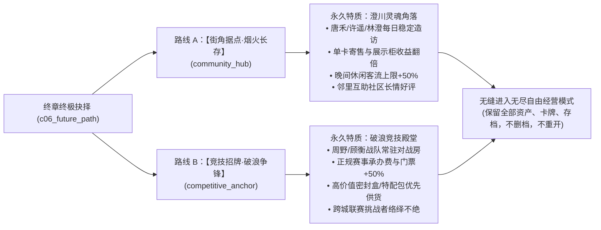

# 剧情分支后果与终极收束路线定义 (CV6-19)

> **核心原则**：
> 1. **无惩罚式分歧**：玩家的经营理念选择没有非黑即白的“正确与错误”。不同选择代表不同的商业模式与生活态度，均有其对应的收益与代价。
> 2. **可见真实后果**：选择不是只改变几句台词，而是改变客群构成、常客进店频率、特定货品周转率、比赛活动类型与终极店铺特质。
> 3. **无死锁与失败容错 (N08)**：任何对决失败、缺钱缺卡、活动延期或暂时拒绝，均有明确的“继续营业”与“重新尝试”出口，绝不让主线停摆或强行卡死。

---

## 1. 核心关键选择矩阵与可见后果

### 选择点 1（首章）：接待优先级抉择 (`c01_priority`)
- **语境**：完成首笔密封卡包销售后，许遥（寻访老卡）与周野（平民对局）同时进店，林澄在旁注视。
- **选项 A：【先聊收藏】 (`visitPriority = 'collection'`)**
  - **可见后果**：次日早晨许遥优先进店翻阅柜台，提前解锁单卡展示柜与旧卡寻访支线；周野在旁安静看卡包，其切磋考核移至晚间或次日。客群中收藏型散客的进店意愿略微提前。
  - **台词变化**：林澄赞许“把老物件的来历弄明白，店就有了根”；许遥感激被认真对待。
- **选项 B：【先看练习】 (`visitPriority = 'practice'`)**
  - **可见后果**：当天下午周野优先占用对战桌发起入门构筑交流，提前解锁牌技切磋与平民构筑测试；许遥在一旁做笔记，单卡收购线顺延。店内对战桌活跃度提升。
  - **台词变化**：林澄提醒“年轻人的手感要趁热磨，但别忘了空肚子打不长久”；周野斗志昂扬。
- **选项 C：【今天先顾店】 (`visitPriority = 'later'`)**
  - **可见后果**：许遥与周野礼貌道谢并退至顾客等待区，模态暂停立即释放，玩家全速投入首日收银理货。两人在次日营业开始时依序回访，**没有任何好感惩罚或主线阻断**。
  - **台词变化**：林澄点头“先把第一天的账算清楚，比什么虚的都强”。

---

### 选择点 2（第二章）：流通散卡的去向抉择 (`c02_three_way_choice`)
- **语境**：一张带有历史流转痕迹的旧基础单卡出现在柜台（真实拾牌或单卡交易）。
- **选项 A：【店内展示陈列】 (`cardFate = 'display'`)**
  - **可见后果**：该卡被放入店内非卖品展示柜（`shop.showcase`），不可出售。每天为店铺带来固定的【文化声誉加成】，增加高预算收藏家和怀旧老玩家的进店率；代价是占用了1格单卡资金与栏位。
  - **NPC反馈**：许遥会定期带同好前来看展；林澄感叹老店的气息终于回来了。
- **选项 B：【按公允市价出售】 (`cardFate = 'market'`)**
  - **可见后果**：该卡进入正常单卡寄售栏位，按现行三档价格或市场估值售出。为店铺直接回笼现金，提升孟岚对本店现金周转率的评价；代价是无法激活展示柜的额外声誉加成。
  - **NPC反馈**：孟岚认可店长的商业理性；许遥虽然略感惋惜，但认同“好卡流转到需要的人手里也是宿命”。
- **选项 C：【放入个人借阅卡册】 (`cardFate = 'binder'`)**
  - **可见后果**：该卡放入对战桌旁的公共借阅盒。周野、唐禾等牌手在店内对战时可免费借用，使平民常客的满意度显著提升，夜间平民对战场次增加；代价是不产生直接现金收益。
  - **NPC反馈**：周野深受感动并在对局中更卖力切磋；唐禾下班后来店更频繁。

---

### 选择点 3（第四章）：社区外展展台定位 (`c04_stall_choice`)
- **语境**：韩序邀请卡店走出店门，承办灯桥街社区青年文化日的展示区。
- **选项 A：【零基础大众普及区】 (`stallDirection = 'casual'`)**
  - **可见后果**：展台主打十分钟速通教学与简单预组。唐禾等工薪阶层、亲子客群大幅涌入。活动结束后，小店永久解锁【大众休闲客群】高概率夜间造访特质，工作日晚间客流稳定。
  - **韩序评价**：“社区中心需要的就是这种烟火气，每个人走过都能坐下摸两张牌。”
- **选项 B：【青年高手挑战擂台】 (`stallDirection = 'challenge'`)**
  - **可见后果**：展台主打三局两胜挑战赛与构筑研讨。周野与附近高校牌手聚集，吸引年轻硬核牌手。小店获得【高阶竞技声誉】，周末正规赛事报名人数上升。
  - **顾衡评价**：“有点意思，看来你们不仅会照顾客人，骨子里也有竞技的刺。”

---

### 选择点 4（第五章）：季前赛战队支持策略 (`c05_team_strategy`)
- **语境**：澄川杯季前赛拉开序幕，破军俱乐部顾衡广发英雄帖。
- **选项 A：【高额赞助精英构筑】 (`teamStrategy = 'elite'`)**
  - **资金消耗**：消耗一定流动资金储备为选手购置主流高强度套牌。
  - **可见后果**：战队获胜概率大幅提高，若夺冠将在街区声名大噪，获得丰厚奖金分成与大牌赞助商关注；若失利则承担较高的沉没成本。
- **选项 B：【平民互助打磨配合】 (`teamStrategy = 'grassroots'`)**
  - **资金消耗**：极低资金消耗，依靠周野、林澄与店长的战术针对性打磨。
  - **可见后果**：无论比赛最终名次如何，全队凝聚力达到顶峰。即便惜败，也能赢得全街区牌友的起立鼓掌，顾衡亦会公开向这种钻研精神致敬。
- **选项 C：【店长亲自披挂上阵】 (`teamStrategy = 'manager'`)**
  - **玩法要求**：店长必须在真实的规则引擎对局中亲自出战。
  - **可见后果**：胜负完全取决于店长的临场打牌决策。胜利将直接解锁个人传奇牌手成就；即使失利，也能在复盘中获得第一手战术数据，且经营不受波及。

---

## 2. 终章两种平等的积极收束路线

主线第六章《下一场在这里》的终局抉择（`c06_future_path`）提供两种完全对等、均充满自豪感的终局形态：

### 路线 A：【街角据点·烟火长存】 (`endingRoute = 'community_hub'`)
- **定位**：这间店不是为了制造高高在上的冠军而生，而是为了给澄川每一个在生活之余热爱卡牌的人保留一盏温暖的明灯。
- **剧情收束**：
  - 林澄正式成为店铺常任顾问，坐在靠窗的旧位置上微笑看着满座宾客；
  - 许遥将小店评为“澄川最完整的卡牌记忆档案馆”；
  - 唐禾每天下班推门进店，疲惫的面容在看到空出的3号桌时瞬间释然；
  - 韩序代表街道送来“澄川青年友好文明示范据点”奖牌挂在门楣上。
- **后续玩法特权**：
  - 解锁【社区沙龙】特殊活动类型；
  - 单卡流转与二手寄售手续费减免，稀有旧卡寻访事件概率提高；
  - 夜间营业顾客容忍度提升，工作日晚间客流增加。

### 路线 B：【竞技招牌·破浪争锋】 (`endingRoute = 'competitive_anchor'`)
- **定位**：用无可辩驳的牌技与严谨正规的赛训体系，将昔日冷清的街角小店打造成全省乃至全国闻名的竞技圣地。
- **剧情收束**：
  - 周野在赛场上身披本店战袍，捧起个人生涯第一座高规格亚军/冠军奖杯；
  - 顾衡登门送上正式的联合联赛承办协议，承认小店在专业水准上已与破军俱乐部并驾齐驱；
  - 孟岚将全省最稀缺的官方赛事限定包直供额度优先分配给本店；
  - 店内荣誉墙挂满对局记谱本与战队队旗。
- **后续玩法特权**：
  - 解锁【城市巡回公开赛】高规格承办资格；
  - 赛事报名费与转播分成收益提升；
  - 吸引外地高水平挑战者定期上门交流，促进高单价箱装商品周转。

---

## 3. 容错、异常与抗阻塞规则 (N08 合规)

1. **缺钱/破产边缘**：
   - 若玩家现金流紧张无法推进主线活动（如举办大型比赛资金不足），剧情自动进入【自由积累观察态】（`waiting_for_funds`）。林澄或孟岚会给出保守的进销存建议，不催缴罚款，直到玩家通过自由营业累积足额资金后再次提示开启。
2. **缺卡/断货**：
   - 任何涉及特定单卡的剧情（如许遥寻卡），均支持【寻找替代基础卡】或【从卡册借阅】；若货架全部空置，NPC会给出正常的缺货反馈（`FeedbackReason: 'out-of-stock'`），并触发孟岚的补货指引，绝不触发逻辑死锁。
3. **真实赛果战败**：
   - 牌技考核战败时，周野或裁判 NPC 会说：“这套牌在抓牌节奏上有点脱节，我们复盘一下，你调整好随时再来叫我。”对战记录真实计入历史，对战桌恢复可用，玩家可无限次重新发起切磋。
4. **存档与跨日一致性**：
   - 所有分支选择与 flag 在确定瞬间由事务写入 `world.narrative.flags`，随日初档与即时档同步落盘。读档后游标精确定位至对应节点，绝无“读档后选项重置或奖励重复发放”的隐患。
