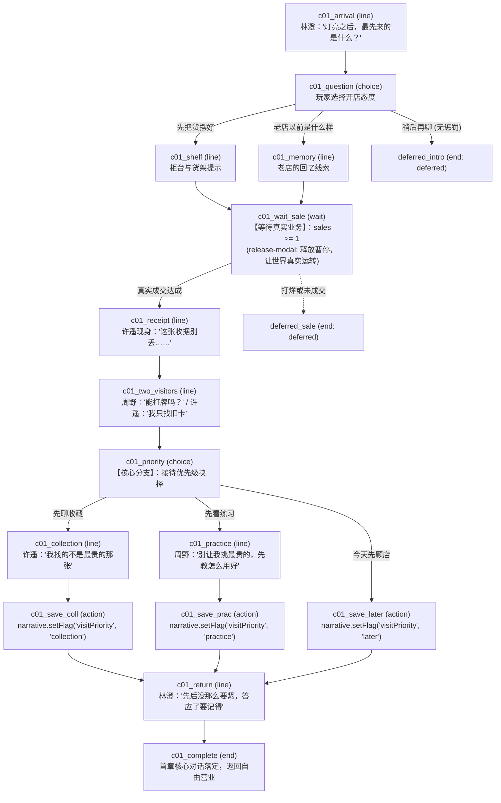

# CV6-19 至 CV6-20 首章台本扩写交接标准文档

> **交接目标**：
> 本文档为 **CV6-20（首章台本与角色支线）** 提供完备的剧情骨架、人物人格特征、稳定 ID 规范、场景节点流转图、业务谓词/动作映射与抗异常回退规则。
> CV6-20 接手后可直接据此撰写完整的 `chapter_01.story.json` 与 `text/zh-CN.json`，无需再对人设、分支后果或业务边界进行二次猜测。

---

## 1. 首章基本元数据与文件规范

- **战役标识 (`campaignId`)**：`corner_card_shop`
- **章节标识 (`chapterId`)**：`chapter_01`
- **章节全名**：第一章《第一张收据》 (The First Receipt)
- **前置序章**：`chapter_00`《灯亮之前》（开店准备阶段）
- **真源分离规范 (02规格)**：
  - 流程拓扑必须写入结构化流程文件（如 `chapters/chapter_01.story.json`）；
  - 所有展示台词必须抽取为稳定 `lineId`，存入多语言包（如 `text/zh-CN.json`）；
  - 严禁在流程节点中硬编码中文对话文本；严禁根据台词哈希生成动态 ID。

---

## 2. 登场角色及人设指引（CV6-20 撰写台词基准）

在首章实际登场的角色共 3 位原创人物：

| `personId` | 姓名 | 角色职能与在场状态 | 语调风格与台词特征（严禁套用外部武将/二次元人设） |
| --- | --- | --- | --- |
| `person_lin_cheng` | 林澄 | 老店守望者、在柜台旁观望并提点店长 | 话语简练、沉稳克制、见惯起伏。习惯用客观物件（如收据、招牌、椅子）阐述道理，不作无意义的嘘寒问暖，关键时刻一语中的。 |
| `person_xu_yao` | 许遥 | 卡牌编目者、随第一笔成交进店 | 谦和文雅、专注细致、轻声慢语。对卡牌背后的流转痕迹抱有极大敬意，珍视第一张收据的纪念价值，反感纯粹的投机炒作。 |
| `person_zhou_ye` | 周野 | 囊中羞涩的平民年轻牌手、与许遥同时进店 | 快人快语、直接坦率、带有少年特有的倔强和不服输。渴望用平民基础卡证明实力，反感“不氪金就不能赢”的言论。 |

---

## 3. 首章节点流转与拓扑图 (Topology)

首章从营业中引入，经真实第一笔密封商品销售触发主事件，随后展开许遥与周野的双人进店、接待优先级三向抉择、对应展开、林澄复盘寄语，直至日终营业复盘收束。



---

## 4. 详细节点表与稳定 `lineId` 映射表

下表为 CV6-20 在 `text/zh-CN.json` 中必须落地的台词清单：

| 节点标识 (`nodeId`) | 节点类型 | 说话人 (`speakerId`) | 稳定文本标识 (`lineId`) | 中文意图参考（CV6-20以此为基准扩写自然对话） |
| --- | --- | --- | --- | --- |
| `arrival` | `line` | `person_lin_cheng` | `c01.arrival` | “灯真的亮了。我还以为这块招牌只剩下照路的用处。” |
| `question` | `choice` | `null` | `c01.question` | “先做什么？” |
| - 选项 1 | - | - | `c01.stock` | “先把货摆好。”（导向 `shelf`） |
| - 选项 2 | - | - | `c01.memory_option` | “这家店以前是什么样？”（导向 `memory`） |
| - 选项 3 | - | - | `c01.later` | “今天先把店顾好，稍后再聊。”（导向 `deferred_intro`） |
| `shelf` | `line` | `person_lin_cheng` | `c01.shelf` | “那我先不挡柜台。卖出去的第一包，记得给自己留张收据。” |
| `memory` | `line` | `person_lin_cheng` | `c01.memory` | “比赛日坐不下人。后来大家各忙各的，椅子倒是一张没少。” |
| `wait_sale` | `wait` | `null` | - | 条件：`predicateId: "metric.atLeast", params: { metric: "sales", value: 1 }`，`pausePolicy: "release-modal"` |
| `receipt` | `line` | `person_xu_yao` | `c01.receipt` | “这张收据别丢。以后你会记得，第一位顾客到底买了什么。”（支持实际商品插值） |
| `visitors` | `line` | `person_zhou_ye` | `c01.visitors` | “你这里能打牌吗？我想知道，手里这些牌能打到哪一步。” |
| `priority` | `choice` | `null` | `c01.priority` | “接下来先聊什么？” |
| - 选项 1 | - | - | `c01.collection_option` | “先聊收藏。”（导向 `collection`） |
| - 选项 2 | - | - | `c01.practice_option` | “先看练习。”（导向 `practice`） |
| - 选项 3 | - | - | `c01.contact_later` | “今天先把店顾好，稍后再聊。”（导向 `save_later`） |
| `collection` | `line` | `person_xu_yao` | `c01.collection` | “我找的不是最贵的那张。有人记得它，就够了。” |
| `practice` | `line` | `person_zhou_ye` | `c01.practice` | “别让我挑最贵的。先教我怎么把已有的牌用好。” |
| `return` | `line` | `person_lin_cheng` | `c01.return` | “先后没那么要紧。你答应了什么，明天还记得，就已经比空桌子好。” |
| `effect_failed`| `line` | `null` | `c01.effect_failed` | “当前无法记录这项安排。可以稍后再谈，店铺仍能正常营业。”（异常回退出口） |

---

## 5. 业务谓词与语义动作注册清单 (冻结约束)

CV6-20 在台本流程中引用的业务动作必须严格限制在以下已核准能力内，**严禁手写任意 JavaScript 表达式或直接篡改金币/卡库**：

1. **等待条件 (`wait.condition`)**：
   ```json
   {
     "predicateId": "metric.atLeast",
     "params": {
       "metric": "sales",
       "value": 1
     },
     "sourcePolicy": "actual-business"
   }
   ```
   *说明：监听真实后端经营事务中的 `sales` 指标。若当日未售出，次日开门后继续保持监听，绝不伪造虚假交易。*

2. **写入旗标动作 (`action.actionId: "narrative.setFlag"`)**：
   ```json
   {
     "nodeId": "save_collection",
     "type": "action",
     "effectId": "priority_collection",
     "actionId": "narrative.setFlag",
     "params": {
       "flagId": "visitPriority",
       "value": "collection"
     },
     "onSuccess": "return",
     "onFailure": "effect_failed"
   }
   ```
   *说明：`effectId` 必须全局唯一且幂等；当持久化成功后流转至 `return`，失败时流转至 `effect_failed` 并安全挂起。*

3. **释放模态暂停策略 (`pausePolicy: "release-modal"`)**：
   - 凡涉及 `wait`（如等待开包、等待第一笔成交、等待顾客进门）的节点，必须显式声明 `release-modal`，关闭模态遮罩，让游戏时钟和顾客 AI 正常运作。严禁在模态暂停状态下挂起等待游戏时间流逝。

---

## 6. 异常、延期与断网回退指南 (N01 / N08)

1. **缺货情况**：若玩家首日未上架商品或顾客预算不足未达成销售，`wait_sale` 节点在打烊结算时触发 `onDeferred: "deferred_sale"`。次日开门后自动重新挂起监听，无需玩家重复触发开场白。
2. **读档恢复**：若玩家在选择优先级界面退出游戏，读档后游标直接恢复到 `priority` 节点，旗标保持未设置状态，不重置前序对话，亦不重复触发首单庆祝。
3. **文本插值安全**：收据台词 `c01.receipt` 若无法从上下文获取第一笔商品的具体名称，必须优雅回退为默认字串“第一包商品”，绝不能显示 `undefined`、`null` 或 `[Object object]`。
