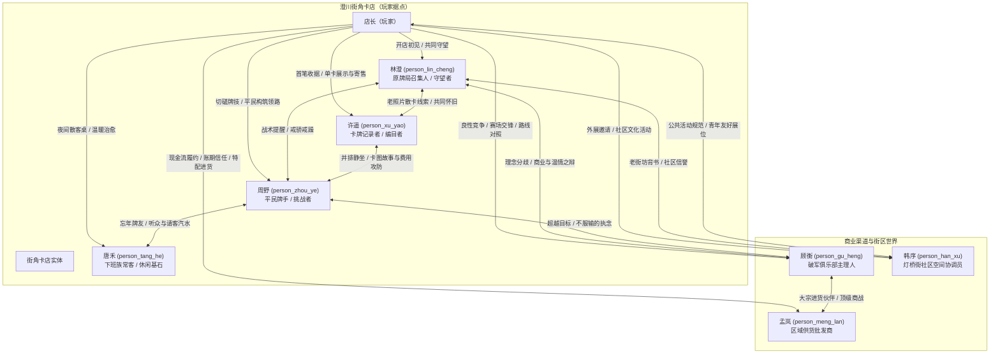

# 澄川街角卡店角色关系图谱与动态机制 (CV6-19)

> **核心原则**：
> 1. **原创人格**：所有角色均为独立原创设定，外形资产仅为软映射，严禁套用外部武将或二次元原型人设。
> 2. **契约与履约驱动**：好感与信任源自实际业务履约（如稳定开店、按时结款、提供对局场地、认真对待普通卡），**严禁‘连续送礼刷好感’的数值灌水**。
> 3. **全局唯一单例**：存档内同一角色拥有唯一 `personId`，禁止生成同名随机路人分身。

---

## 1. 角色关系网络图 (Mermaid)



---

## 2. 关系维度与数值规范

在 `world.narrative.relationships` 中，每名角色的关系状态结构定义如下：

```json
{
  "personId": "person_lin_cheng",
  "trustLevel": 1,        // 整数 0 ~ 5，表示信赖等级
  "reputationPoints": 20, // 0 ~ 100，当前等级积累点数
  "stance": "supportive", // "neutral" | "cautious" | "supportive" | "partner"
  "unlockedTopics": ["old_gathering", "shelf_advice"],
  "pledges": [            // 承接的承诺与履约记录
    {
      "pledgeId": "pl_friday_gathering",
      "status": "pending", // "pending" | "fulfilled" | "breached"
      "dueDay": 5
    }
  ]
}
```

### 关系成长途径（纯业务与事件驱动）

| 角色 | 信任提升事件 (正向) | 信任受损/冷淡行为 (负向) | 严禁的灌水行为 |
| --- | --- | --- | --- |
| **林澄** (`person_lin_cheng`) | 按时开门营业、遵守交流会约定、不把老桌椅当杂物变卖、首日认真复盘 | 承办比赛爽约放鸽子、盲目高杠杆借贷濒临倒闭、关店歇业多日无交代 | 严禁送礼刷好感；不提供无理由无限免费帮工 |
| **许遥** (`person_xu_yao`) | 建立店内单卡展示柜、保留流通记录卡、按公允市价交易旧卡、认真倾听卡牌历史 | 强行将具有纪念意义的寄存卡随意熔炼或溢价倒卖、以‘稀有度即一切’嘲讽普通卡 | 严禁抽卡赌博SSR进贡；许遥只关注卡牌背后的故事 |
| **周野** (`person_zhou_ye`) | 提供空闲对战桌、完成基础对局切磋（无论胜负）、提供平民战术指导 | 拒绝普通牌手借桌、因其消费低冷嘲热讽、私自篡改比赛规则 | 严禁直接赠送高级SSR强行跳级；必须依靠真实引擎切磋成长 |
| **顾衡** (`person_gu_heng`) | 在商业竞争中信守协议、季前赛派出有实力的队伍堂堂正正对决、展现健康的单店周转率 | 毁约弃赛、使用违规卡组或恶意拖延、打翻商业合作合同 | 顾衡非反派，无须讨好；纯粹由对局水平和商业表现衡量 |
| **孟岚** (`person_meng_lan`) | 批次货款当日结清、维持安全现金流储备、完成特配卡包预售委托 | 恶意拖欠账款、囤货倒卖劣质假卡、单方面违约退货 | 孟岚不搞人情赊账，不收礼品；一切凭发票和回款单说话 |
| **唐禾** (`person_tang_he`) | 保持晚间18:00后营业灯光、提供整洁安静的对战座位、平价饮品与散卡包供应 | 晚上仅服务大客户并驱赶散客、强行推销昂贵箱装商品 | 唐禾是普通打工人，不需要复杂任务，需要的是稳定的街角庇护所 |
| **韩序** (`person_han_xu`) | 严格遵守社区中心活动秩序与静音规范、为新手玩家提供耐心免费教学 | 在社区中心大声喧哗、诱导未成年过度消费、撤摊时不清理场地垃圾 | 韩序代表社区公共利益，以公益普及度和场地整洁度为唯一考核 |

---

## 3. 动态分支与冲突缓解机制

1. **多重访问不打架**：
   - 当多名角色在同一时间段访问卡店时，依据 `visitPriority`（首章设定的玩家接待偏好）排定对话气泡顺序，其余角色在店内闲逛（看展示柜、在对战桌观战、在货架前选购），绝不强行并发挤占玩家窗口。
2. **拒绝/延后零惩罚**：
   - 玩家若处于紧迫补货或高客流收银状态，所有剧情交互均提供【今天先把店顾好 / 稍后再聊】选项。该选项释放当前模态焦点，角色礼貌退至一旁或约定明日再来，**不扣除信任点数，不产生负面惩罚**。
3. **真实赛果容错**：
   - 所有涉及牌技切磋（如周野切磋、顾衡季前赛）的节点，均具备战胜（Victory）与战败（Defeat）两条完备的文案与逻辑分支。战败不会导致游戏 Game Over 或剧情锁死，而是引导玩家复盘战术、优化构筑后再次发起切磋。
