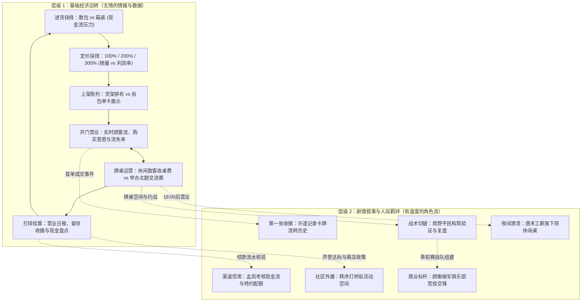

# 成熟经营决策循环与叙事结合研究 (decision-loops.md)

> **任务标识**：CV6-01 成熟经营与剧情产品研究
> **核对日期**：2026-10-25
> **现行规则基准**：三档价 100/200/300、NPC对局不暂停不跳时、玩家整场对局加30分钟一次、KOF新将摸四张不继承手牌。

---

## 1. 每日双层决策循环模型

---

## 2. 核心机制对比与本作定位

| 机制维度 | 竞品典型做法 (TCG Simulator / Recettear) | 本作商业版 V6 设计方案 | 优势与规避的陷阱 |
| --- | --- | --- | --- |
| **定价策略** | 无级滑块定价或盲目拉高价格 | **离散三档定价（100 / 200 / 300）**，与商品品相/稀缺度联动 | 规避玩家频繁微调每个金币的繁琐操作；让定价成为战略级博弈。 |
| **NPC对局时钟** | 游戏画面完全冻结或全部跳过模拟 | **NPC对局后台自然流逝不暂停；玩家对决整场暂停一次并推进30分钟** | 保障玩家打牌有沉浸感，同时店内经营时间真实消耗，避免时间作弊。 |
| **角色关系** | 连续送礼、买东西堆叠好感度条 | **基于业务履约、真实切磋与按期结款（无送礼刷好感）** | 人格真实立体，尊重角色职业尊严，杜绝快餐数值灌水。 |
| **剧情推动** | 强制要求抽中特定 0.1% 概率稀有 SSR 卡 | **仅需真实密封商品成交或基础单卡流转** | 拒绝赌博伪随机锁死主线，平民玩家依然顺畅推进。 |
| **失败后果** | 破产强制删档或高利贷奴役 Game Over | **营业继续、复盘战术、保守进货指引，无限次重试** | 尊重玩家沉没时间，营造温暖可长青的治愈卡店生态。 |
